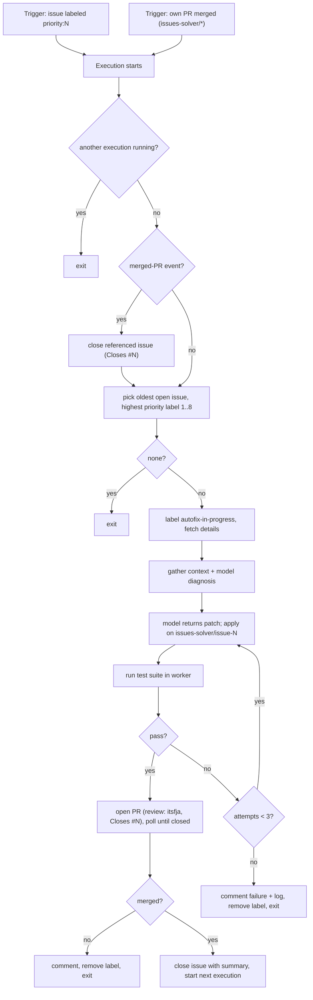

# Mistral issues solver

A [Mistral Workflow](https://docs.mistral.ai/studio/workflows/overview) that works through the prioritized open
issues of `itsfja/second-thought` (`priority: 1` first, up to `priority: 8`, oldest first within a level) and opens
a pull request for each fix.

## What one execution does

1. **Guard** — exits quietly if another execution of `mistral-issues-solver` is already running (the current
   execution and, for chained runs, its parent are excluded).
2. **Pick** — if started by a merged-PR event, closes the issue that PR referenced (`Closes #N`). Then queries open
   issues labeled `priority: 1`…`priority: 8` and picks the highest priority (lowest number), oldest first; exits if
   none.
3. **Label** — adds `autofix-in-progress` to the issue and fetches its details and comments.
4. **Understand** — gathers the repo tree, code-search hits and key docs, then asks the model for a diagnosis.
5. **Fix** — the model returns a JSON patch (full file contents); paths are validated against the repo tree. The
   patch is applied on branch `issues-solver/issue-<N>` (running `python tools/sync.py` when generated files are
   affected) and pushed.
6. **Test** — runs `tools/sync.py --check`, unit tests, editor tests, `tests/setup.sh` and
   `tests/run_tests.py --parallel` in the worker. Up to 3 fix attempts; if still failing, an explanatory comment is
   posted on the issue, `autofix-in-progress` is removed, and the execution exits.
7. **PR** — opens a PR (`Closes #N`, review requested from `itsfja`) and polls until it is closed.
8. **Merge** — on merge, closes the issue with a summary comment, removes `autofix-in-progress`, and starts the next
   execution. If the PR is closed without merging, it comments and stops.



## Triggers

Studio webhooks are not available on the current plan, so a tiny GitHub Actions bridge in the target repo
(`.github/workflows/issues-solver.yml` in `itsfja/second-thought`) starts an execution via
`POST /v1/workflows/mistral-issues-solver/execute` when:

- an issue is labeled with a label starting with `priority`, or
- a PR whose head branch starts with `issues-solver/` is merged.

## Setup checklist (one time)

1. Workspace secret `second_thought_gh_token`: a fine-grained PAT for `itsfja/second-thought` with
   *Issues: read/write*, *Pull requests: read/write*, *Contents: read/write*, *Metadata: read*. Bound to the
   deployment as env var `SECOND_THOUGHT_GH_TOKEN`. The token value is never stored in this repo.
2. Actions secret `MISTRAL_API_KEY` on `itsfja/second-thought` (a Mistral API key), used by the bridge workflow.
3. Labels `priority: 1`…`priority: 8` already exist on `itsfja/second-thought`; `autofix-in-progress` is created
   automatically on first use.
4. Deploy (see below).

## Deploy

The managed deployment builds from this repository:

- `github_url`: `https://github.com/itsfja/Mistral-issues-solver-`
- `build_directory`: `.`, `dockerfile_path`: `Dockerfile`
- `deployment_name`: `mistral-issues-solver`
- `secrets`: `second_thought_gh_token` -> env `SECOND_THOUGHT_GH_TOKEN`

The image installs Python 3.12, Node 22, git and Playwright/Chromium so it can run the target repo's full test
suite in-worker. The worker's `MISTRAL_API_KEY` (service account) is used for the Workflows API and the model.

## Development

```
pip install -e .[dev]
python -m pytest -q
```
